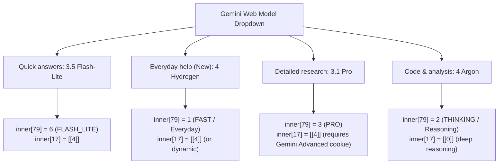

# Google Gemini Web Reverse Engineering Architecture

This document breaks down the internal protocols, RPC structures, serialization formats, and authentication mechanisms used by Google Gemini Web (`gemini.google.com`) and how they are reverse-engineered into an OpenAI / Gemini-compatible REST and SSE API.

---

## 1. Network Protocol Overview

Gemini Web communicates with Google backends via a batched RPC endpoint known as **StreamGenerate**:

- **Method:** `POST`
- **Path:** `https://gemini.google.com{account_prefix}/_/BardChatUi/data/assistant.lamda.BardFrontendService/StreamGenerate`
- **Content-Type:** `application/x-www-form-urlencoded;charset=UTF-8`

### 1.1 URL Parameters

| Parameter | Example Value | Description |
| :--- | :--- | :--- |
| `bl` | `boq_assistant-bard-web-server_20261109.08_p0` | Frontend build label (identifies the web UI version). |
| `hl` | `en` | UI / response language code. |
| `_reqid` | `123456` | Incremental client request identifier. |
| `rt` | `c` | Response transfer encoding flag (streamed batch response). |
| `account_prefix` | `/u/1` (optional) | Account index if using multi-account Google sign-in. |

---

## 2. Request Envelope & Serialization

The HTTP request body is formatted as `application/x-www-form-urlencoded` containing:
1. `f.req`: A JSON array containing a JSON-stringified inner payload array (double JSON encoding).
2. `at`: The XSRF/CSRF token extracted from the Gemini Web page DOM (known internally as `SNlM0e`).

```
f.req=[null,"[\"What is quantum computing?\",...]"]&at=AOOh0P...
```

### 2.1 The 102-Element Inner Array

Google's internal Google Web Toolkit / Closure RPC structures use indexed array slots rather than named JSON objects:

```text
inner = [None] * 102
```

Key slots and their semantic meanings:

| Index | Type | Purpose | Reverse-Engineered Meaning |
| :---: | :--- | :--- | :--- |
| `inner[0]` | Array | User Content | `[prompt_text, 0, null, file_refs, null, null, 0]` |
| `inner[1]` | Array | Locale | `["en"]` |
| `inner[2]` | Array | Context state | `["", "", "", null, null, null, null, null, null, ""]` |
| `inner[6]` | Array | Client flags | `[0]` |
| `inner[7]` | Int | Client type | `1` |
| `inner[10]` | Int | Web capability | `1` (enables Google Search grounding) |
| `inner[17]` | Array | **Thinking Mode** | `[[think_mode]]` (`0`=Deep, `2`=Medium, `4`=Auto/Shallow) |
| `inner[27]` | Int | Formatting | `1` (Markdown formatting allowed) |
| `inner[30]` | Array | Modality flags | `[4]` |
| `inner[41]` | Array | Chat History | `[1]` for temporary chats, `[2]` for persistent chats |
| `inner[45]` | Int | History sync | `1` if temporary chat |
| `inner[59]` | String | Session UUID | Client-generated UUID v4 |
| `inner[79]` | Int | **MODE_CATEGORY** | Model category selection enum |

---

## 3. Model Categories (`inner[79]`)

From Gemini Web's bundled frontend scripts (e.g. `028-6eb337387583.js`):

```javascript
var MODE_CATEGORY = {
  FAST: 1,                    // Quick / Everyday help (Flash / Hydrogen)
  THINKING: 2,                // Deep reasoning / Code & analysis (Argon / Flash-Thinking)
  PRO: 3,                     // Advanced / Detailed research (3.1 Pro)
  AUTO: 4,                    // Dynamic upstream routing
  FAST_DYNAMIC_THINKING: 5,   // Adaptive reasoning
  FLASH_LITE: 6               // Quick answers (3.5 Flash-Lite)
};
```

### Mapping to the Gemini Web UI Dropdown



---

## 4. Authentication: Cookies & SAPISIDHASH

When anonymous access is used, Gemini Web generates a session with limited Pro routing and standard rate limits. When authenticated:

1. **Required Cookies:**
   - `SID`, `HSID`, `SSID`, `APISID`, `SAPISID`
   - `__Secure-1PSID`, `__Secure-1PSIDTS`
2. **SAPISIDHASH Generation:**
   Google requires an `Authorization` header containing a SHA-1 hash of the timestamp, `SAPISID` cookie, and origin:
   $$\text{timestamp} = \lfloor\text{current\_time\_seconds}\rfloor$$
   $$\text{hash} = \text{SHA1}(\text{timestamp} + \text{" "} + \text{SAPISID} + \text{" https://gemini.google.com"})$$
   $$\text{Authorization} = \text{"SAPISIDHASH "} + \text{timestamp} + \text{"\_"} + \text{hash}$$

---

## 5. Response Parsing & Streaming (`wrb.fr`)

Responses are returned as batched lines prefixed with lengths and encoded in framing arrays:

```text
)]}'
1234
[["wrb.fr",null,"[null,null,null,null,[[...],[\"Here is the answer...\"]]]",...]]
```

### Extraction Algorithm
1. Identify lines containing the chunk identifier `"wrb.fr"`.
2. Parse the outer JSON array to retrieve inner JSON string at index `arr[0][2]`.
3. Parse the inner JSON string into `inner`.
4. Text candidates reside at `inner[4][i][1]`.
5. For streaming SSE (`/v1/chat/completions` with `stream: true`), the proxy calculates text diffs (`delta = current_text[len(previous_text):]`) and emits standard OpenAI SSE events:
   ```json
   data: {"choices":[{"delta":{"content":"..."}}]}
   ```
6. Post-processing cleans internal tracking artifacts, including card citations (`http://googleusercontent.com/card_content/...`) and internal execution block tags.
